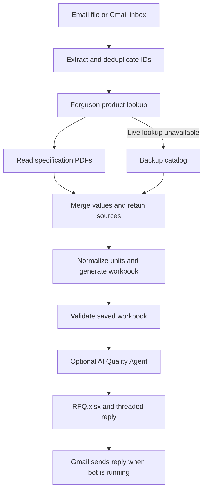

# Day 4 starter kit: the Ferguson RFQ challenge

Follow the Day 4 guide shared by your instructor. It walks you through Part A (build the base), Part B (your agentic arm), deploying on Azure, and how you are judged.

## What is in this kit

| Folder | What it is |
|---|---|
| `emails/` | Four sample request emails as `.eml` files. Python reads them with the built-in `email` package. `rfq_items.xlsx` is the attachment inside email 2, also saved on its own. |
| `data/` | The backup product catalog, where every value came from, and the spec sheet PDF links. See `data/README.md`. |
| `templates/rfq_template.xlsx` | The RFQ template your flow fills: RFQ sheet, Sources sheet, and a "How to fill" sheet. |
| `reference/email-1 reference output.xlsx` | The correct output for email 1. Test your Part A against it. |

## The emails

| File | What makes it different |
|---|---|
| `email-1-ids-in-body.eml` | Product IDs in the email body, one per line |
| `email-2-ids-in-attachment.eml` | Product IDs in an Excel attachment |
| `email-3-mixed-ferguson-and-competitor.eml` | Ferguson IDs and competitor part numbers in one list |
| `email-4-messy-forward.eml` | A forwarded thread: IDs inside sentences, with `#` in front, one ID listed twice |

## Ground rules

- Blank means unknown. Never guess a value.
- Every value you fill needs a source on the Sources sheet.
- A product you cannot find stays on the RFQ sheet as `Not found`.
- The original kit included no solution code. The implementation is now described below.
- Keep your API keys in a `.env` file. It is already ignored by git, so it is never uploaded.

## RFQ automation implementation: FERG_GOAT_QUOTE

The bot is named **FERG_GOAT_QUOTE**: it signs and sends replies under that name, and the dashboard carries it.

The project now reads RFQ emails and Excel attachments, looks up product information, fills the supplied template, and creates a threaded reply draft. Gmail mode sends the reply automatically. The original kit description above is retained for context.

### Quick start

Use Python 3.11 or newer locally; the Azure deployment guide targets Python 3.11.

```powershell
python -m venv .venv
.venv\Scripts\Activate.ps1
python -m pip install -r requirements-dev.txt
# Only copy this if .env does not already exist:
Copy-Item .env.example .env
python build.py emails/email-1-ids-in-body.eml --offline
```

The output is in `out/email-1-ids-in-body/`:

- `RFQ.xlsx`: RFQ, Sources, Notes, Summary, Commercial, and template instructions.
- `reply.eml`: a threaded reply with the workbook attached. The build command does not send it.
- `summary.json`: counts and field completion percentage.
- `quality-trace.json`: unit-normalization actions and, in AI mode, tool calls.

If PowerShell activation is restricted, use `.venv\Scripts\python.exe` instead of `python`.

### Main commands

```powershell
# Repeatable demo without network or credentials
python build.py --offline

# Background mode (default): scrapes ferguson.com in a hidden Chrome the app starts, then PDF, then catalog
python build.py emails/email-2-ids-in-attachment.eml --mode background

# Live demo mode: the audience watches each product page load in the visible Chrome.
# Start that Chrome first:
#   & "C:\Program Files\Google\Chrome\Application\chrome.exe" --remote-debugging-port=9333 --user-data-dir="$env:TEMP\chrome-rfq" https://www.ferguson.com/
python build.py emails/email-1-ids-in-body.eml --mode live --demo-delay 2

# No Chrome at all (as on Azure): HTTPS attempt, PDFs, catalog
python build.py emails/email-2-ids-in-attachment.eml --no-browser

# AI Quality Agent (requires OPENAI_API_KEY and OPENAI_MODEL in .env)
python build.py emails/email-3-mixed-ferguson-and-competitor.eml --quality ai

# Build a draft from the real Gmail inbox without sending
python mailbot.py --once --dry-run --offline

# Automatically reply to unread RFQ emails every 30 seconds
python mailbot.py

# Tests do not send real emails or require API credentials
python -m pytest -q
```

### Architecture



### Source and quality rules

- Sources are applied field by field in a fixed order: Ferguson's internal product service first (product-info-v3; batches of 100 IDs, Ferguson network only), then the ferguson.com page, then the spec sheet PDF, then the backup catalog. A lower source never overwrites a higher one; real disagreements are written to Notes.
- The catalog fills only fields still blank after the website and PDF (or everything when the website lookup fails). Each catalog-filled field is listed in Notes with its original evidence. A product the website no longer lists is not revived from the catalog.
- PDF values must be explicit single values. Exact model matches are high confidence; family sheets for the item's part prefix are medium confidence and flagged; option lists are skipped.
- Two scraping modes, same sources: `live` shows the scraping in the visible Chrome (port 9333) for a demo; `background` runs the same scraping in an off-screen Chrome the app starts (port 9334). Live mode stops with instructions if its Chrome is not running.
- All populated RFQ and Commercial cells have matching Sources rows. Catalog provenance retains original confidence. Medium-confidence values are flagged; low-confidence pattern values are omitted.
- Unknown products remain as `Not Found`. Competitor search is not implemented because this project selects the Quality Agent option.
- `rules` mode checks units, coverage, missing values, suspicious numeric values, and citations. It is deterministic and needs no API key.
- `ai` mode adds a bounded tool-calling review. The model inspects product evidence and records warnings; it cannot change specifications. Missing credentials or an unsuccessful AI review cause an explicit failure rather than being presented as a successful agent run.
- The RFQ sheet retains the original 23-column template. Pricing, availability, and additional identity fields are on Commercial, with historical catalog warnings on Notes.

### Email 1 comparison

Offline, background, and live runs each matched all 138 RFQ cells and IMAGE formulas in `reference/email-1 reference output.xlsx` (checked 2026-10-16). In live and background runs 142 of the values came straight from ferguson.com. Sources, Notes, and additional sheets intentionally include more information than the reference. Live prices/specifications may change, so a live run is not expected to reproduce a historical workbook exactly.

Excel's IMAGE function requires a compatible Excel version and network access. The picture URL is also included as text.

### Agentic arm: RFQ Quality Agent

The quality agent (`app/agent.py`) judges every RFQ value against the source it came from: **verified**, **inferred**, **conflict** or **issue**, each with evidence.

Its tools:
- `inspect_product`
- `read_source` (page excerpt, PDF text, catalog record)
- `compare_family`
- `check_standard` (APWA utility colour code, ASTM/OSHA/ANSI formats)
- `record_finding`
- `propose_fix`

A rules planner runs every check on every run, offline and on Azure. With `--quality ai`, a model (gpt-5) plans its own investigation with the same tools.

A proposed fix must quote a value a source already states, otherwise it is rejected. It is applied only after a person approves it in the dashboard, which regenerates `RFQ.xlsx` with source `agent_fix` and keeps `RFQ-original.xlsx`.

Results are in:
- the **Agent Review** sheet;
- the Summary sheet;
- the request drawer in the dashboard, with Approve/Reject buttons and the step-by-step agent trace.

```powershell
python build.py emails/email-2-ids-in-attachment.eml --quality ai   # AI planner (needs OPENAI_API_KEY, OPENAI_MODEL)
python build.py emails/email-2-ids-in-attachment.eml --offline     # rules planner only
```

### Dashboard

Every RFQ is recorded in a local SQLite database, `out/rfq.db` (git-ignored; set `RFQ_DB` to move it, or `RFQ_DB=off` to disable). Each request row holds the sender, subject, arrival time, status (`replied`, `built`, `dry_run`, `skipped`, `failed`, `processing`), scraping mode, product counts, fields filled, and reply time. One row per product holds its status and how many values came from ferguson.com, the PDF, and the catalog. `mailbot.py` records Gmail requests, and `build.py` records file runs. Recording never blocks an RFQ: a database error is logged and the reply still goes out.

```powershell
# One-time: build the React app
cd frontend; npm install; npm run build; cd ..

# Serve the dashboard and its API on http://127.0.0.1:8000 (this computer only)
python dashboard.py

# Run the bot in a second terminal; the dashboard refreshes every 5 seconds
python mailbot.py
```

The dashboard shows:
- **Tiles:** RFQs sent, emails received, products processed, average response time (email arrival to reply), products found, RFQ fields filled, and failed requests.
- **Emails received vs RFQs sent** per day.
- **Where the filled values came from:** ferguson.com, spec sheet PDF, or catalog.
- **Requests table:** filter by source (Gmail, file runs, API) and date range. Select a row to see its products and download its `RFQ.xlsx`.

**Simulation panel.** The panel sends a real test RFQ from a second Gmail account to the bot and tracks it live: sent → picked up by the bot → RFQ built → reply sent. Set it up in `.env`:

```dotenv
SIM_SENDER_EMAIL=your-test-sender@gmail.com   # must differ from BOT_EMAIL
SIM_SENDER_PASSWORD=xxxxxxxxxxxxxxxx          # that account's 16-letter App Password
```

Start from one of the four sample emails or write your own, and optionally attach the sample `rfq_items.xlsx`. Safeguards:
- The recipient is always `BOT_EMAIL`, so the panel cannot email anyone else.
- Sends are accepted only from the dashboard page on this computer: JSON-only, with an Origin check against other websites.
- At most one email every 10 seconds and 30 per hour.
- Nothing is uploaded.

The reply goes back to the sender account. `python mailbot.py` must be running for the email to be answered.

Light and dark themes are supported, and every chart has a table view. For frontend development with hot reload, run `npm run dev` in `frontend/` (port 5173, API proxied to port 8000) alongside `python dashboard.py`.

API: `GET /api/metrics`, `GET /api/requests`, `GET /api/requests/<id>`, `GET /api/requests/<id>/rfq.xlsx`, each with optional `source=` and `days=`. The server binds to 127.0.0.1 because the data includes customer email addresses. Azure runs with `RFQ_DB=off`: its app folder is read-only and it has no dashboard.

### Project files

| File/folder | Purpose |
| --- | --- |
| `app/` | Extraction, lookups, quality review, workbook generation, pipeline, Gmail logic, database (`store.py`), and dashboard API (`dashboard_api.py`) |
| `build.py` | Process one `.eml` file |
| `mailbot.py` | Poll Gmail and send replies |
| `dashboard.py` | Serve the dashboard and its API locally |
| `frontend/` | React + Vite dashboard (`npm run build` writes `frontend/dist`) |
| `function_app.py` | Azure HTTP routes and optional Gmail timer |
| `data/`, `templates/`, `emails/`, `reference/` | Original starter assets |
| `tests/` | Acceptance and failure-path tests |
| `spec.md` | Input, Steps, Run, Rules, Done When |
| `docs/run.md` | Chrome, Gmail, AI setup, and troubleshooting |
| `docs/azure.md` | Azure deployment and verification |
| `docs/evaluation.md` | Judging criteria and demo sequence |
| `refrence.md` | Business process explanation |

The mailbox implementation is `app/mailbox.py`, avoiding a root `mailbox.py` that would shadow Python's standard-library module.

### Live setup still required

Local tests do not establish live Gmail delivery, model access, or successful Azure deployment. Configure those services and perform the checks in [the run guide](docs/run.md) and [Azure guide](docs/azure.md). Existing repository remote: [ferguson-rfq-starter-kit](https://github.com/Tanmaya-kh/ferguson-rfq-starter-kit).
