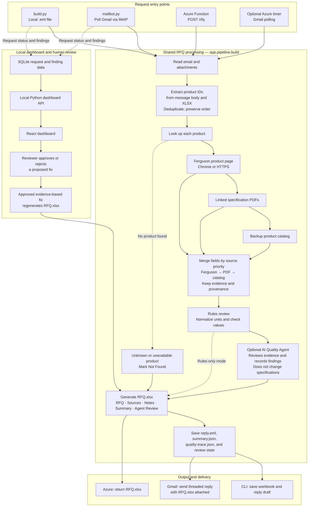

# RFQ Workflow Architecture

The file-based CLI, Gmail bot, and Azure Functions entry points converge on the shared RFQ pipeline. Product values retain their source evidence, and lower-priority sources only fill fields left blank by higher-priority sources.

## Workflow notes

- Lookup order is Ferguson product page, specification PDF, then the backup catalog. Source precedence is applied field by field.
- Rules-based quality checks run every time. AI review is optional and advisory; it cannot overwrite product specifications.
- The CLI saves a reply draft. The Gmail bot sends the threaded reply and attached workbook. Azure's HTTP route returns the workbook.
- The local dashboard reads request data from SQLite. A reviewer-approved fix is applied only when supported by existing evidence, then the workbook is regenerated.
