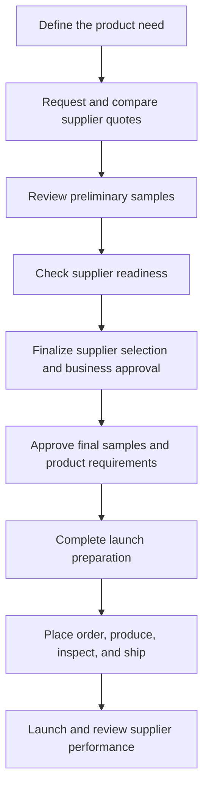
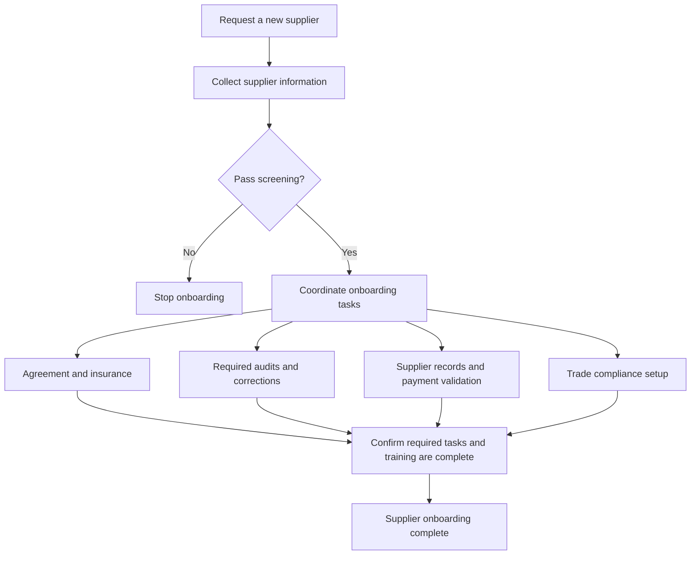
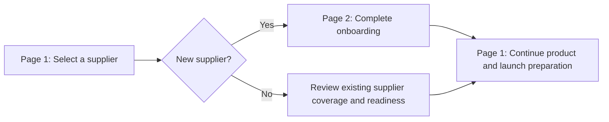

# Global Sourcing Process — Simple Guide

Source: `Global Sourcing Process v14 1 (1).vsdx`

This guide explains the two pages in simple terms. The diagrams below summarize the main steps; they do not show every approval or exception in the original file.

| Page | Main question |
| --- | --- |
| **Page 1: Stage Gate** | Is the product ready to buy and launch? |
| **Page 2: Supplier Sourcing & Onboarding** | Is the supplier ready to do business with Ferguson? |

## Page 1: From product request to launch

A **stage gate** is a review point. The team checks the work and gets the required approval before moving forward.

### 1. Define what is needed

Product Development and Sourcing agree on the product requirements:

- What the product does and how it is installed.
- Material, finish, size, and other specifications.
- Certifications and packaging.
- Expected annual demand and minimum order quantity.

These details form the RFQ or RFP sent to suppliers.

### 2. Compare quotes and preliminary samples

Sourcing selects potential suppliers and reviews their responses. The team checks price, specifications, and whether the product can be manufactured as required.

Suppliers provide preliminary samples and inspection reports. Product Development reviews them and gives feedback.

### 3. Check the supplier and business case

- **New supplier:** Follow the onboarding process on Page 2.
- **Existing supplier:** Check agreement coverage, insurance, certifications, and audits for the new products. Review payment terms if needed.

The team finalizes the supplier, quotation, and preliminary samples, and obtains business case approval where required.

### 4. Confirm the product is ready

The supplier provides final samples and inspection reports. The team completes a checklist covering:

| Area | Simple checks |
| --- | --- |
| Product | Certifications, drawings, specifications, testing, and labels |
| Packaging | Design, artwork, barcodes, and packaging tests |
| Quality | Inspection rules and quality-control forms |
| Logistics | Shipping requirements, dimensions, weight, and loading |

### 5. Prepare, order, and launch

The team confirms the ordering model and completes item setup in the required systems, including Trilogie and Infor.

Before proceeding, supplier readiness checks include the agreement, insurance, factory audit, and trade compliance setup. If the supplier is not ready, the process pauses unless the required exception is approved.

Purchasing issues the purchase order. The teams coordinate production, the first inspection, shipment, and launch.

Placing an order before product listing is complete requires the approval specified in the original diagram.

### 6. Review performance after launch

Sourcing holds supplier reviews and works with Quality, Purchasing, Logistics, and Finance to resolve issues and manage changes.

## Page 2: Make the supplier ready

Supplier onboarding checks the supplier, completes agreements and audits, creates system records, and provides training.

Some activities can overlap. The diagram below groups the work and does not define the exact order of every task.

### 1. Collect information and screen the supplier

Sourcing helps the supplier complete the prospective vendor template.

Credit, Legal, and Trade Compliance teams check financial standing, legal concerns, restricted-party status, and corruption or adverse-media concerns. Failed screening can stop onboarding.

### 2. Complete the agreement and insurance

The team negotiates the Supply Agreement and obtains the Certificate of Insurance.

The agreement is managed in **IronClad**, and insurance documents are kept on record. Insurance exceptions require the approval specified in the source diagram.

### 3. Complete audits and fix issues

The supplier completes the applicable quality, AML, and CTPAT audits. The diagram links AML requirements to suppliers selling into the Industrial Customer Group.

The teams review audit results and follow up on required corrections before approval.

### 4. Set up supplier records

Supplier records are created in the required systems: **Trilogie, Oracle, and Infor**.

Records include company details, addresses, contacts, manufacturing locations, and payment information. The responsible team validates the supplier and payment details.

Supplier setup on this page is separate from the product/item setup on Page 1.

### 5. Complete trade compliance setup

The supplier number is shared with Global Trade Compliance. The team completes the required trade setup, including the International Manufacturer ID.

### 6. Train the supplier

Training covers quality expectations, logistics, Infor, purchase orders, legal conduct, and sourcing processes.

Onboarding is completed once the required setup, audits, trade compliance work, and training are complete.

## How the two pages connect

Product approval and supplier readiness both matter. An approved product still needs a supplier that meets the required checks.

## Where the RFQ starter kit fits

The starter kit supports the early RFQ preparation step on Page 1:

**Read the email → extract product IDs → find product details → fill the RFQ spreadsheet → record sources.**

The full sourcing process continues beyond that spreadsheet, through supplier selection, approvals, onboarding, and launch.

## Common terms

| Term | Meaning |
| --- | --- |
| RFQ | Request for Quotation: ask suppliers for pricing |
| RFP | Request for Proposal: ask suppliers how they would meet a need |
| PD | Product Development |
| MOQ | Minimum Order Quantity |
| FAI | First Article Inspection: checks on initial product samples |
| SA | Supply Agreement |
| COI | Certificate of Insurance |
| GTC | Global Trade Compliance |
| CAR | Corrective Action Request: an issue that needs fixing |
| PO | Purchase Order |

## Notes in the original file

The source includes open questions about supplier record freezing and supplier termination. It also labels the CTPAT dependency for trade setup as an assumption. These points need clarification before being treated as final process rules.
